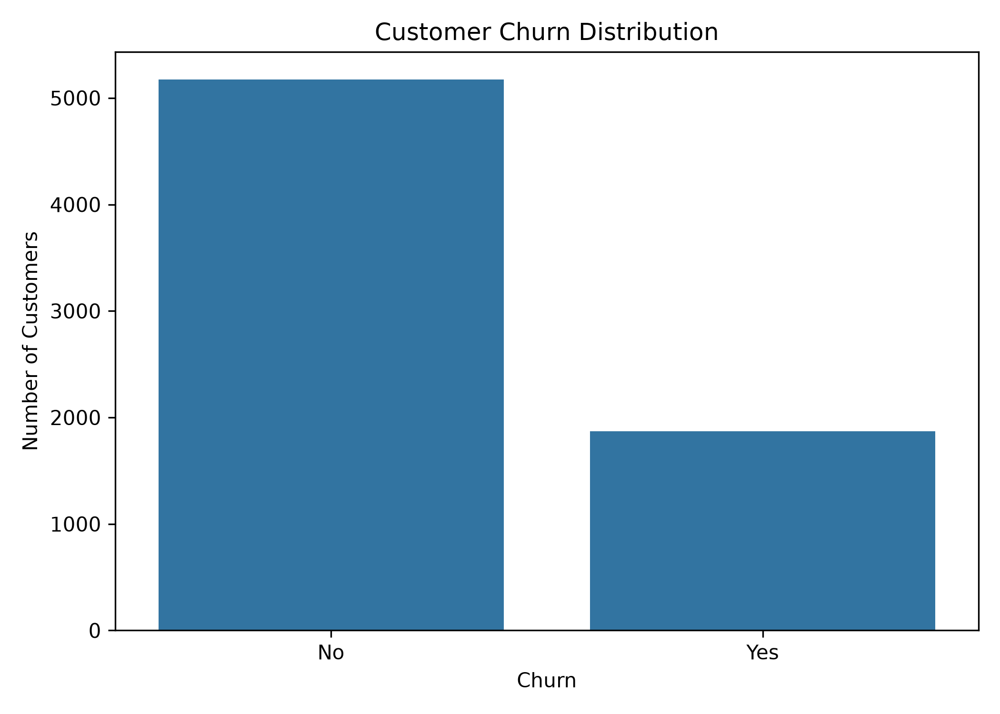
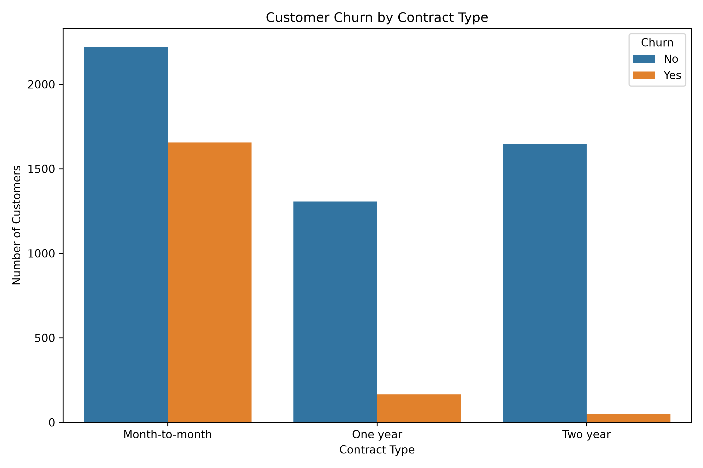
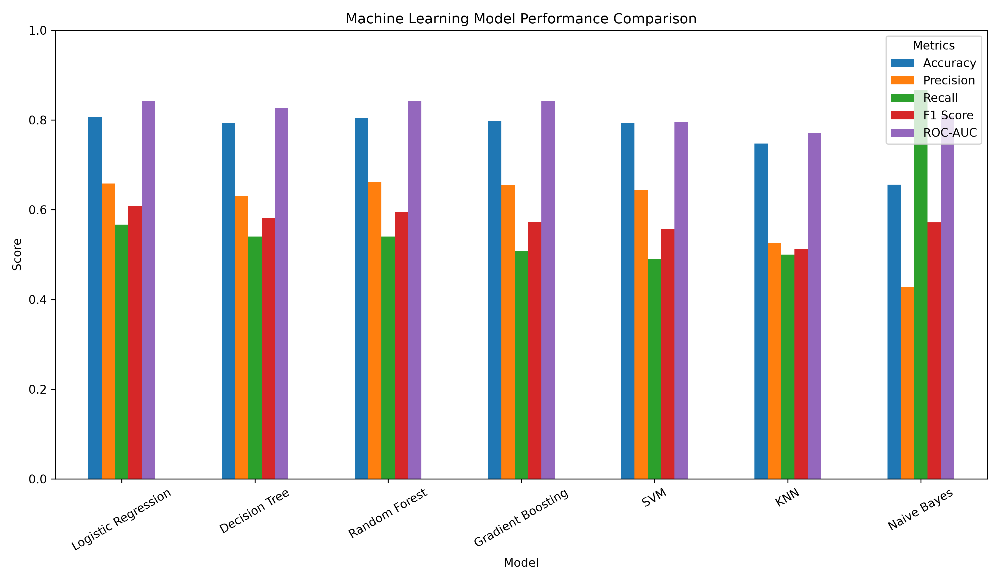
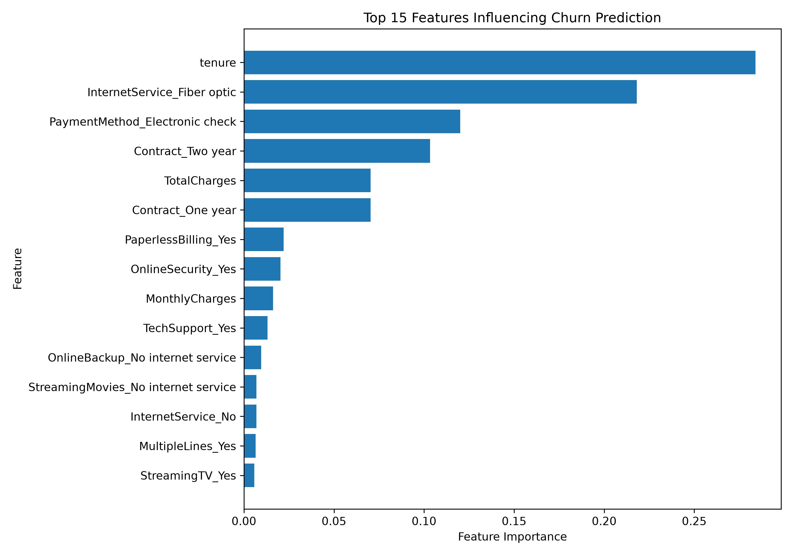
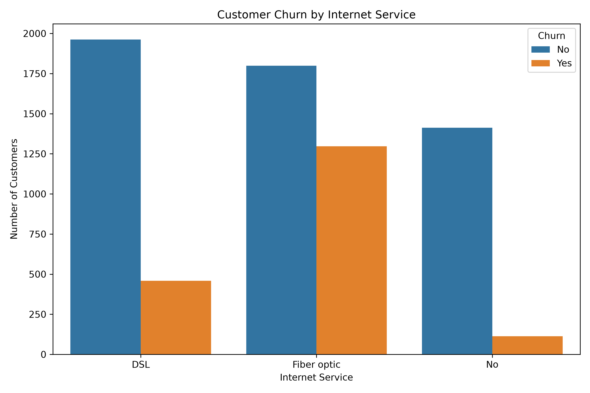
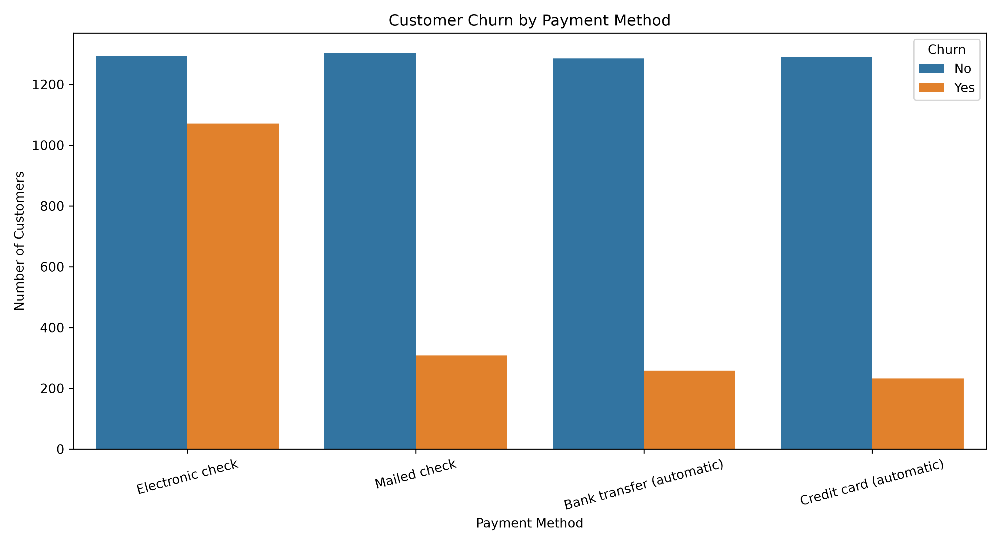
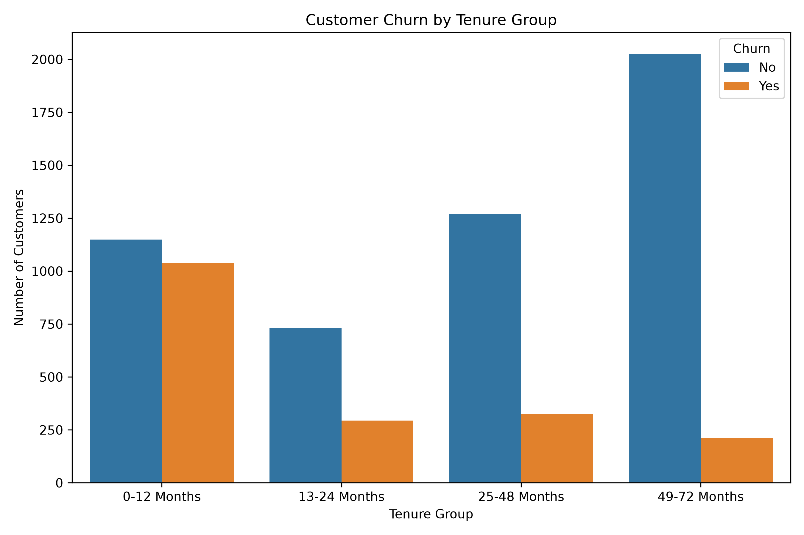
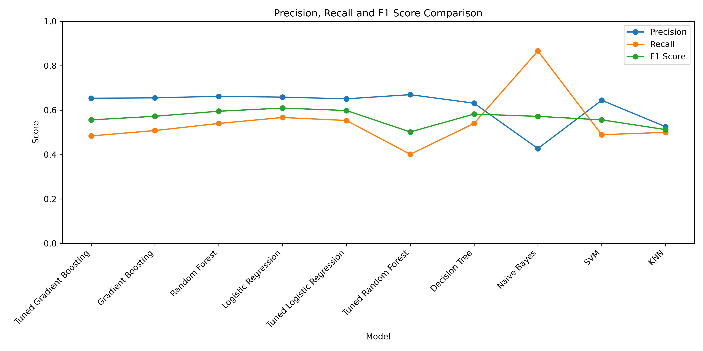

# 📊 Customer Churn Analysis and Prediction Using Machine Learning

## 📸 Project Preview

### Customer Churn Distribution

### Churn by Contract Type

### Model Comparison

### Feature Importance

## 📌 Project Overview

Customer churn is a major challenge for businesses because losing existing customers can directly affect revenue and long-term growth.

This project analyzes **7,043 customer records** to identify patterns associated with customer churn and develops machine learning models to predict customers who are at higher risk of leaving.

The project combines **Exploratory Data Analysis (EDA), statistical analysis, customer segmentation, and machine learning** to generate actionable business insights.

---

## 🎯 Objectives

* Analyze customer characteristics and identify churn patterns.
* Explore the relationship between customer attributes and churn.
* Perform statistical analysis to identify significant associations.
* Build and compare multiple machine learning classification models.
* Tune the best-performing model.
* Identify high-risk customers for potential retention strategies.
* Generate business-oriented insights from the analysis.

---

## 🛠️ Technologies Used

* **Python**
* **Pandas** – Data manipulation and analysis
* **NumPy** – Numerical computing
* **Matplotlib** – Data visualization
* **Seaborn** – Statistical visualization
* **Scikit-learn** – Machine learning
* **SciPy** – Statistical analysis

---

## 📂 Dataset

The project uses a telecommunications customer churn dataset containing **7,043 customer records**.

The dataset includes information related to:

* Customer demographics
* Contract type
* Internet service
* Payment method
* Tenure
* Monthly charges
* Total charges
* Churn status

---

## 🔍 Exploratory Data Analysis

The project investigates several factors related to customer churn, including:

* Churn distribution
* Churn by contract type
* Churn by internet service
* Churn by payment method
* Churn by customer tenure
* Monthly charges vs. churn
* Total charges vs. churn

### Example Visualizations

#### Churn Distribution

#### Churn by Contract

#### Churn by Internet Service

#### Churn by Payment Method

#### Churn by Tenure

---

## 📊 Statistical Analysis

Statistical techniques were used to investigate relationships between categorical variables and customer churn.

### Methods Used

* **Chi-square test**
* **Cramér's V**

These analyses were used to measure the association between customer characteristics and churn.

---

## 🤖 Machine Learning Models

The following classification algorithms were implemented and compared:

1. Logistic Regression
2. Decision Tree
3. Random Forest
4. Gradient Boosting
5. Support Vector Machine (SVM)
6. K-Nearest Neighbors (KNN)
7. Naive Bayes

The models were evaluated using metrics such as:

* Accuracy
* Precision
* Recall
* F1-score
* ROC-AUC

---

## 📈 Model Performance

The model comparison showed different strengths across evaluation metrics.

### Key Results

| Metric   | Model                   |     Result |
| -------- | ----------------------- | ---------: |
| ROC-AUC  | Tuned Gradient Boosting | **0.8462** |
| Accuracy | Logistic Regression     | **0.8070** |
| Recall   | Naive Bayes             | **0.8663** |

The **tuned Gradient Boosting model achieved a ROC-AUC of 0.8462** in the project evaluation.

